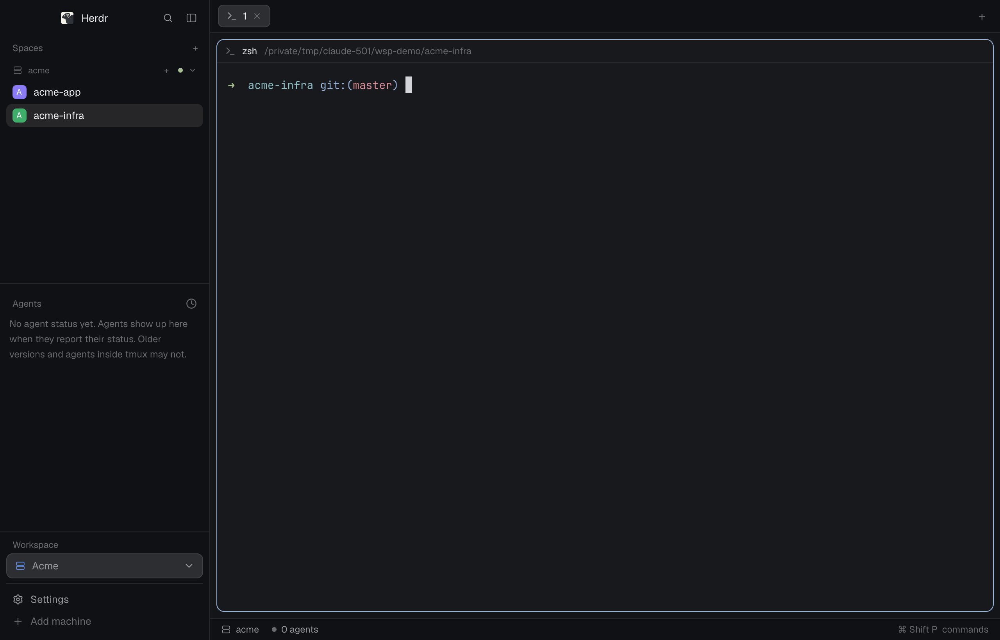

# herdr-workspaces: a workspace switcher layout for the Herdr app

A Herdr app layout and mod (`workspaces`) that groups your spaces into workspaces, so one Herdr window stays tidy when you run many AI coding agents across several herdr-core machines. The sidebar lists only the chosen workspace's spaces (Default, this computer's spaces, by default), with a "Workspace" selector in the footer, set apart from Settings, to pick, create, edit and delete workspaces (name, icon, color, core), and a "Move to workspace…" item in the right-click menu of a space on another machine. The status bar names this computer "default" instead of "This computer". Everything is served by one mod folder, `mods/workspaces/`.



## Features

- Workspaces with a name, an icon (ten to choose from), a color (six) and a core; create, edit and delete them from the footer selector.
- The spaces list and the agents list both show only the active workspace; Default shows this computer's spaces.
- A workspace is its core: pick an attached `sh -c` machine in the Core row of the create/edit dialog (each core belongs to one workspace; the dialog never creates a core). The workspace lists every space of its core.
- Default is this computer's spaces.
- A space on another machine (one no workspace names, such as an SSH host) sits under a header for that machine, and its right-click menu has "Move to workspace…" to list it in a workspace. Spaces of this computer and of a workspace's core have no such item.
- A workspace with no core shows the row "Choose this workspace's core in Edit", which opens the dialog.
- A core is made outside the app with `hc machine add --via 'sh -c' --name <workspace> --session <workspace>`.
- A new space is made on the active workspace's core. To make Cmd+N do that, set `"cmd-n": "workspaces:new-space"` in your `keys.json` (the mod never edits it).
- Agent status (working, blocked, done, idle), sub-agents, git branch and ahead/behind next to each space, a status bar with machine, branch and agent counts.
- The workspace store is one JSON file shared by every window of the app home.

## Install

Ask your Herdr agent to add `herdr.dev/layouts/ejklock/workspaces` (the layout is listed there once the repository carries the `herdr-layout` topic). Herdr tells you before adding it that the mod runs programs and reads files outside its folder; see "What it runs, reads and writes".

Or by hand, from a clone of this repository:

```sh
bin/install ~/.config/herdr-app
```

The script copies `mods/workspaces` (without tests and editor files) and `layouts/workspaces.json` into
the app home; Herdr draws a mod's icons and reloads its edits only from real files, not links. Rerun it
after each change: Herdr picks the edit up in the open window. The copy carries a `.installed-from` file
naming this repository. The layout's side-panel Files block uses the `my-files` mod when the editor
plugin is installed (the default), and Herdr's `files` with `--without editor`. A rerun replaces its own
earlier copy or an earlier link into this repository and refuses anything else (another folder, a foreign
link, a layout file it did not make), checking every target and the source layout before writing any.

## Plugins

`bin/install` also installs the editor plugin from `plugins/editor/` by default; `bin/install --without editor
<app home>` skips it, builds nothing and leaves any editor or `my-files` copy already in the app home
untouched (the layout then goes back to Herdr's `files`). The plugin adds:

- `editor`: an editable file editor pane (save, formatters, conflict handling).
- `my-files`: the side-panel file tree, whose click opens a file in the editor, with a colored icon for each file type.

The plugin is TypeScript, so installing it needs Node and the `typescript` package (`npm install` at the
root of this repository) to build; the workspaces mod needs neither. The build reads Herdr's type files from the app home (`HERDR_APP_HOME`, else `~/.config/herdr-app`).
Its icons keep their own licenses:
`plugins/editor/mods/my-files/LICENSE-herdr-file-icons.txt` (Apache-2.0) and
`plugins/editor/mods/my-files/icons/LICENSE-material-icon-theme.txt` (MIT). See `plugins/editor/README.md`
for what each mod does.

If you used the old `herdr-editor` repository, with a link or a copy of its `editor` or `my-files` mod in
your app home: remove that link or copy (`mods/editor`, `mods/my-files`), then run `bin/install <app home>`.
The installer refuses a link pointing outside this repository and a folder it did not make, and writes
nothing in that case.

## Usage

Switch to the layout and back:

```sh
herdr-app do layout.switch '{"name":"workspaces"}'
herdr-app do layout.switch '{"name":"main"}'
```

In the layout, click the "Workspace" selector in the sidebar footer: pick Default or a workspace, or choose "New workspace…" to give one a name, an icon and a color. Click Edit on a workspace to pick its core; a space on another machine has "Move to workspace…" in its right-click menu to list it there. Each window keeps its own active workspace.

## Layout of the mod

`main.js` picks a role from `props().role` (spaces, agents, chrome, status, menu, switcher, dialog) and delegates
to that role's file. `lib.js` holds the pure store logic; `npm test` runs `lib.test.js`.

The store is `<app home>/workspaces/workspaces.json`; the active workspace of a window is the shared
value `workspaces.active` (absent means Default, this computer's spaces).

## What it runs, reads and writes

Herdr warns installers about mods that reach the network, run programs or read files outside their folder. This one:

- Makes no network request.
- Runs `git` through `exec` (`status --porcelain=v2 --branch`, `rev-parse --show-toplevel`, `rev-parse --git-common-dir`) in each space's folder, on the space's machine (`spaces.js`, `menu.js`).
- Runs `hc machine ls --json` through `hc` every 15 seconds to list attached machines (`spaces.js`), and once when the workspace dialog opens, to list the cores to pick (`dialog.js`).
- Reads and writes `<app home>/workspaces/workspaces.json` (creating the folder) and watches that folder for changes by other windows.
- Watches the git folder of each local repository a space is in, to refresh the branch and ahead/behind marks.
- Uses the shared state keys `workspaces.active` and `workspaces.store`, and, as the shipped mods do, `space.colors`, `agents.sort`, `sidebar.width`, `sidebar.collapsed` and the `localStorage` keys `machines.folded`, `changed` and `pins`.
- Draws icons from its own folder and from the shipped `mods/workspace-chrome/` folder.

## Requirements

- The Herdr app, built and checked on `herdr-app` 0.1.10 (the shipped mods and layout it derives from are 0.1.9).
- `git` on the machine of each space, for the branch marks.
- `hc` to attach other cores as machines (optional).

## Derived from shipped mods (Herdr 0.1.9)

| File | Derived from |
|---|---|
| `spaces.js` | `spaces` |
| `agents.js` | `agents` |
| `menu.js` | `menu` |
| `chrome.js` and the SVGs | `workspace-chrome` |
| `status.js` | `workspace-status` |
| `dialog.js` | `prompt` (text field) |
| `switcher.js` | `menu` (popup) |
| `layouts/workspaces.json` | `main` |

## Development

```sh
npm test                                   # this repository's tests, then each plugin's
bin/install <scratch app home>
herdr-app check <scratch app home>/mods/workspaces
```

`RECIPE.md` is the brief another agent can build the layout from.

## License

MIT, see `LICENSE`.
