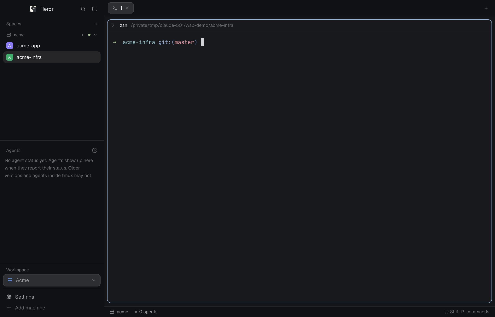

# Workspaces

A Herdr app layout for people who work across several companies or clients. The sidebar lists only the spaces of the workspace you chose (Default, the spaces in no workspace, until you pick one), and its agents list follows the same filter. A "Workspace" selector in the footer, above Settings, opens a menu to pick, create, edit and delete workspaces, each with a name, an icon and a color. A space's right-click menu has "Move to workspace…". Spaces on other herdr-core machines are grouped under a header per machine, and the local machine reads "default".

**What you see:**

The window is a row: a 268px sidebar on the `chrome` background and the work area. Canvas background is `canvas`; dividers are 1px `border`; no title bar, traffic lights at `[12, 16]`; terminal padding `[14, 12]`.

Sidebar, top to bottom:
- Brand row, 46px, draggable window area: the Herdr logo (`frame/welcome/herdr.png`, 20px, radius 5) and "Herdr" (semibold); a search button (opens mod `picker`) and a sidebar toggle button, each 26px. On macOS the row has 76px of left padding for the traffic lights.
- Spaces list, weight 1, min 90px: a 31px header "Spaces" with a "+" button (`space.new`); below it rows of 30px (28px for a worktree row) with an 18px avatar (radius 5, the space's first letter, white, bold 10.5px, one of six hues: `#22a99a`, `#e3814f`, `#5b8def`, `#8b7cf6`, `#3fae6a`, `#d9649a`), the name (max 150px) and, right-aligned, the git tail (repo and branch when they add something, green `↑n` ahead, red `↓n` behind). The active space has the `selected` background. When another machine is attached, a 26px header per machine (server or monitor icon, name or "default", a "+" for a new space on it, a status dot, a fold chevron) precedes its rows. With a workspace active, a machine with no space in it is not listed; an empty workspace shows "No spaces in <name>".
- Agents list, weight 1, min 90px: header "Agents" with a sort button; sections "Needs you", "Done", "Working", "Idle" (Priority sort) or one group per space (Grouped by space); an empty list reads "No agent status yet. Agents show up here when they report their status. Older versions and agents inside tmux may not."
- Footer, 140px: a 22px "Workspace" label, the selector (32px high, radius 8, 1px `border`, `raised` background: the workspace icon in its color, its name or "Default", a chevron-down), a 1px divider, then "Settings" and "Add machine" rows (28px).

Work area, top to bottom: tabs (mod `tabs`, 42px, draggable); the body (padding 8, gap 8) with the main pane (header 30px always shown, 1px `border`, focus ring 1px `accent`, radius 10, gap 8) and a hidden 368px side panel (min 280, max 900) stacking `files` and `changes`; and a 28px status bar.

Status bar: machine icon and name ("default" for the local machine), the branch when the active space has one, "n agents" with a dot, "· n needs you" in the `blocked` color when any agent is blocked, and on the right "⌘ Shift P  commands" ("Ctrl Shift P  commands" off macOS).

**How it behaves:**

- Agent status: working shows a spinning `spinner.svg` (12px, `working` color, 900ms); blocked shows a "Needs you" pill (`blocked` color, 15% background; a 14px "!" box under the "Needs you" header); done shows a filled 7px dot in the `done` color; idle shows a 7px ring (1.5px). Looking at a done agent turns it idle but it stays under "Done" until you leave it. A row shows how long it has been in its state (`<1m`, `5m`, `2h`, `3d`) and, on hover, a pin button; pinned agents go first under "Pinned". Click an agent row to `pane.focus` its pane; click a sub-agent to `terminal.peek` it.
- Workspace selector: click opens a 260px-wide popup (height `10 + 9 + (workspaces + 2) × 32`, at most 480) with Default, each workspace (icon, name, a check on the active one, a pencil to edit), a separator and "New workspace…". Choosing one makes it active for this window; Default clears it. Creating a workspace makes it active.
- Workspace dialog (420x420): Name field (Enter saves, Esc cancels), ten icons, six colors (theme names `ansi6`, `ansi3`, `ansi4`, `ansi5`, `ansi2`, `ansi1`, shown as the six hues above). Edit mode adds Delete, then Confirm delete; deleting the active workspace goes back to Default. Names are unique ignoring case and may not be empty; the error shows under the field.
- Space menu (right-click a space): Rename, Move to workspace…, New worktree and Open worktree (inside a git checkout), Remove worktree (inside a linked worktree), Close. "Move to workspace…" opens a 220px popup listing Default and the workspaces, a check on the current one; a failed write shows an error toast "Could not move the space".
- Changes to the store file by other windows or mods are followed live; the sidebar does not need a reload.
- The sidebar rail: the toggle (or dragging the edge below 160px) collapses the sidebar to a rail; spaces then show their number and a status glyph.
- Git: each space's repo is asked with `git status` when it appears, when a command or an agent turn ends in it, when its machine reconnects, and every 60 seconds for repos in view while the window is active.

**Built from:**

Layout `layouts/workspaces.json`, cloned from the shipped `main` layout (0.1.9). Node tree: `root` row → `sidebar` column (px 268, min 44, max 480, `resizable: false`) [`brand` block px 46 `window_drag`; `sidebar-lists` column [`spaces` block weight 1 min 90; `agents` block weight 1 min 90]; `sidebar-footer` block px 140] and `work` column [`tabs` block (mod `tabs`, px 42, `window_drag`); `work-body` row (padding 8, gap 8) [`main` block (tab `active`, pane header mod `pane`, panes `lone: true`), `panel` column px 368 hidden with a `stack` of `files` and `changes` blocks]; `status` block px 28].

One mod folder, `mods/workspaces/` (`mod.json`: `place: none`, title "Workspaces", cloned from `spaces` 0.1.9), one entry `main.js` that picks a role from `props().role` and delegates:

| role | file | used by | derived from |
|---|---|---|---|
| `chrome` | `chrome.js` | `brand` block; `sidebar-footer` block with `footer: true` | `workspace-chrome` |
| `spaces` | `spaces.js` | `spaces` block | `spaces` |
| `agents` | `agents.js` | `agents` block; the sort popup (`sortMenu: true`) | `agents` |
| `status` | `status.js` | `status` block | `workspace-status` |
| `menu` | `menu.js` | popup, `tab` is `space`, `workspace-move`, `pane`, `tab` or global | `menu` |
| `switcher` | `switcher.js` | popup from the footer selector | `menu` (popup) |
| `dialog` | `dialog.js` | dialog overlay from the switcher and "New workspace…" | `prompt` (text field) |

`lib.js` holds the store logic and imports nothing from `herdr`, so `node --test` runs `lib.test.js`. Icons: the mod's own SVG files (`mods/workspaces/*.svg`: check, chevron-down, plus, search, settings, sidebar, square-pen, and the ten workspace icons folder, server, monitor, terminal, git-branch, archive, clock, file-text, files, circle-check, plus layers for Default) and, for the machine headers, agent states, chevrons and menus, the shipped `mods/workspace-chrome/` SVGs. Also uses the shipped mods `tabs`, `pane`, `files`, `changes`, `picker`, `machine-add` and `worktree`, and the image `frame/welcome/herdr.png`.

Store: `<app home>/workspaces/workspaces.json`, `{ "version": 1, "workspaces": [{ "id", "name", "icon", "color" }], "assign": { "<spaceId>": "<workspaceId>" } }`. The id of a new workspace is its name as a dashed slug, numbered if taken. Writes go through `writeTextFile(path, text, expected)` and are tried up to 3 times when the file changed meanwhile. A bad file reads as an empty store.

Shared state (`shared()` / `setShared()`): `workspaces.active` (the active workspace id; absent or null is Default) and `workspaces.store` (the last store read, so the first frame has data). The mod also reads and writes `space.colors` (avatar hues), `agents.sort`, `sidebar.width` and `sidebar.collapsed`, and `localStorage` keys `machines.folded`, `changed` and `pins`.

`herdr` functions and commands called: `spaces`, `machines`, `panes`, `agents`, `terminals`, `focused`, `layout`, `window`, `theme`, `keys`, `props`, `appHome`, `shared`, `setShared`, `setAgentOrder`, `readTextFile`, `writeTextFile`, `watchFolder`, `openOverlay`, `closeOverlay`, `notify`, `updates`, `exec`, `hc`, `run`; commands `space.new`, `space.select`, `space.move`, `space.rename`, `space.close`, `pane.focus`, `pane.split`, `pane.zoom`, `pane.close`, `terminal.peek`, `terminal.park`, `terminal.right_click`, `tab.rename`, `tab.new`, `tab.close`, `layout.resize`, `app.settings`, `app.palette`, `app.help`, `app.theme`, `mod.open`.

Programs it runs: `git` through `exec` (`git --no-optional-locks -c core.fsmonitor=false status --porcelain=v2 --branch`, `git rev-parse --show-toplevel`, `git rev-parse --path-format=absolute --git-common-dir`), on the space's machine; and `hc machine ls --json` through `hc`, every 15 seconds, to list attached machines. It watches each local repo's git folder with `watchFolder`. It makes no network request.

**Watch out:**

- Everything depends on `<app home>/workspaces/` existing; the mod creates it (`mkdir` recursive).
- Herdr draws a mod's SVGs and reloads edits only from real files: copy the mod folder, never link it.
- The active workspace is per window and held in shared state; the store file is shared by every window of the same app home.
- Default is not stored: it is the spaces assigned to no workspace (or to a deleted one).
- A workspace can hold local spaces and spaces on other machines; the id of a remote space is machine-prefixed.
- Each company or client core attaches as a machine with `hc machine add --via 'sh -c' --name <name> --session <session>`; the mod does not do that for you.
- The "Workspace" popup height is capped at 480px, so a very long list scrolls.
- Moving a space does not move its terminals: the filter only hides spaces and their agents.
- Icon names are limited to the ten listed; an unknown stored icon draws as `layers`.
- The mod reads files outside its folder (the store file, local git folders) and runs programs (`git`, `hc`).
- A workspace in its own window is not built.

**Done when:**

- `herdr-app check mods/workspaces` passes.
- `node --test` in the repository passes.
- `herdr-app do layout.switch '{"name":"workspaces"}'` succeeds and `herdr-app status` shows `"layout": "workspaces"` and `"errors": []`.
- With `workspaces/workspaces.json` holding workspaces `acme` and `personal` and the shared key `workspaces.active` set to `acme`, only the spaces assigned to Acme are listed, the footer selector reads "Acme" and Default lists only unassigned spaces.
- Choosing "New workspace…", typing a name and pressing Enter adds it to `workspaces.json` and makes it the active one.
- "Move to workspace…" in a space's right-click menu changes that space's entry under `assign` in the file.
- With a second core attached (`hc machine add --via 'sh -c' --name acme --session <session>`) and Default active, its spaces are listed under an "acme" header and the local header reads "default".
