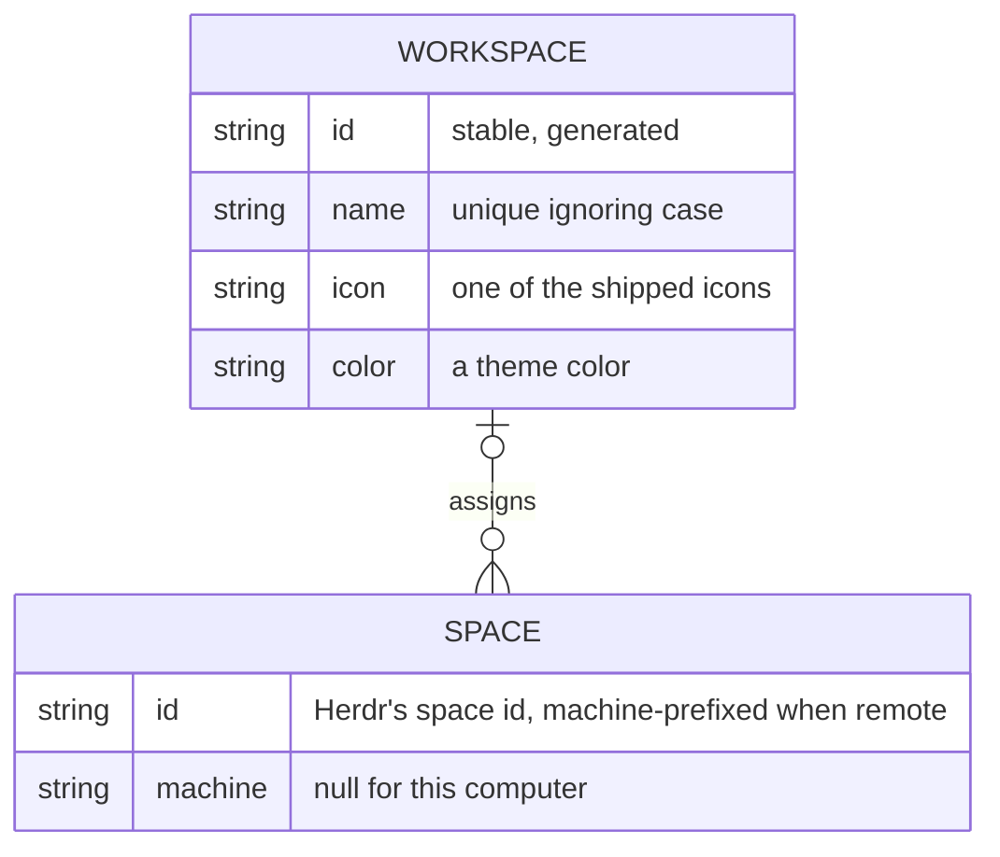

# herdr-workspaces constitution

## Product

Herdr desktop app mods and layouts that let one person work across several companies' terminal workspaces (for example `default`, `company-a`, `company-b`, `company-c`) in one Herdr window, switching between workspaces they define, each with a name, icon and color.

## Scope Boundaries

**In scope:**

- Clones of Herdr's shipped mods and layouts, and new mods, installed into a Herdr app home from this repository.
- Attaching each company's herdr-core session to the main window as a machine.

**Explicitly out of scope:**

- Patched or copied Herdr.app bundles (own Dock icon or name per company): the owner asked for an official, Herdr-only way.
- Distinct Dock or Cmd+Tab entries per workspace: one app stays one app.

**Phase boundaries:**

- Phase 1: the workspace switcher in the sidebar: Default (the spaces in no workspace) first, create, edit and delete workspaces, assign spaces from the space menu, the local machine labelled "default".
- Phase 2: open a workspace in its own window.

## Data Model / Schema Foundation

A workspace groups spaces; a space belongs to at most one workspace, and an unassigned space shows only under Default. Default is not stored: it is the absence of an active workspace, and it lists only the spaces in no workspace. The active workspace is chosen per window.

## Non-negotiables

- Herdr's shipped mods and layouts are never edited; changes go through `mod.clone` and `layout.clone` copies kept in this repository.
- Each company's terminals stay in their own herdr-core session; nothing merges or moves them between cores.
- Going back to the shipped `main` layout always restores the stock Herdr sidebar.

## Amendment Log

Amendments are appended here as `## Amendment N — YYYY-MM-DD: summary`; the sections above are not edited once ratified.
