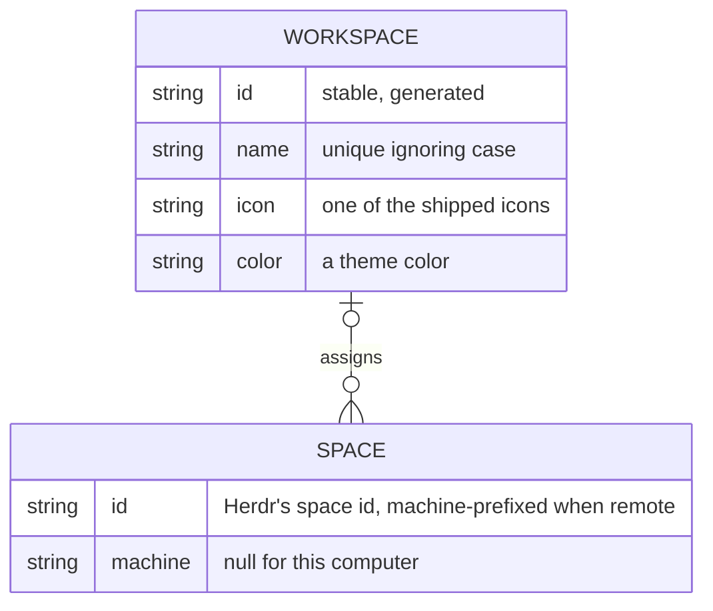
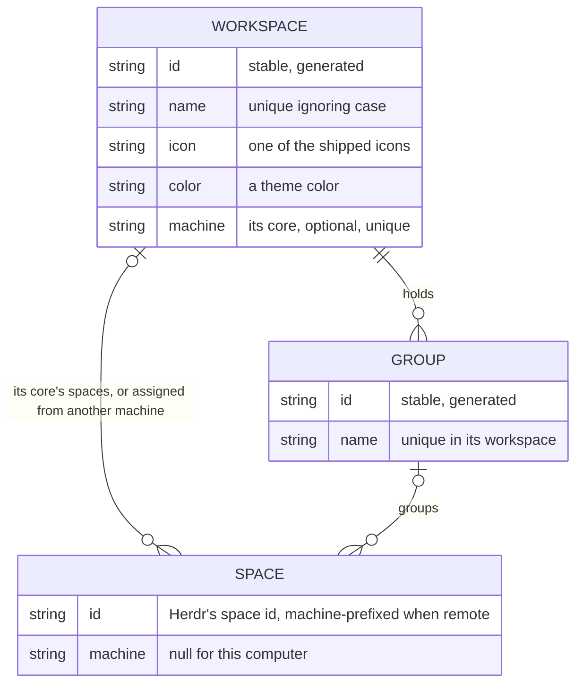

# herdr-workspaces constitution

## Product

Herdr desktop app mods and layouts that let one person work across several workspaces (for example `default`, `workspace-a`, `workspace-b`, `workspace-c`) in one Herdr window, switching between workspaces they define, each with a name, icon and color.

## Scope Boundaries

**In scope:**

- Clones of Herdr's shipped mods and layouts, and new mods, installed into a Herdr app home from this repository.
- Attaching each workspace's herdr-core session to the main window as a machine.

**Explicitly out of scope:**

- Patched or copied Herdr.app bundles (own Dock icon or name per workspace): the owner asked for an official, Herdr-only way.
- Distinct Dock or Cmd+Tab entries per workspace: one app stays one app.

**Phase boundaries:**

- Phase 1: the workspace switcher in the sidebar: Default (the spaces in no workspace) first, create, edit and delete workspaces, assign spaces from the space menu, the local machine labelled "default".
- Phase 2: open a workspace in its own window.

## Data Model / Schema Foundation

A workspace groups spaces; a space belongs to at most one workspace, and an unassigned space shows only under Default. Default is not stored: it is the absence of an active workspace, and it lists only the spaces in no workspace. The active workspace is chosen per window.

## Non-negotiables

- Herdr's shipped mods and layouts are never edited; changes go through `mod.clone` and `layout.clone` copies kept in this repository.
- Each workspace's terminals stay in their own herdr-core session; nothing merges or moves them between cores.
- Going back to the shipped `main` layout always restores the stock Herdr sidebar.

## Amendment Log

Amendments are appended here as `## Amendment N — YYYY-MM-DD: summary`; the sections above are not edited once ratified.

## Amendment 1 — 2026-11-02: a workspace is its core; groups; optional plugins

The owner chose on 2026-11-02 to hide the machine layer and to bring the editor into this repository.

- A workspace may name its core (`machine`, an attached `sh -c` machine no other workspace names); every space on that core belongs to the workspace without an assignment, and Default is the local core's spaces. A space's assignment (`assign`) is kept only for spaces on another machine, one no workspace names, such as an SSH server ([issue 0002](/issues/0002-sidebar-without-machine-headers-each-workspace-bound-to-its-core.md)).
- A workspace holds named groups, one level deep, and a space is in at most one group of its workspace ([issue 0003](/issues/0003-space-groups-in-the-sidebar.md)).
- In scope: optional plugins kept self-contained under `plugins/`, installed by the same `bin/install`, the first being the editor and my-files mods ([ADR 0003](/adr/0003-optional-plugins-live-self-contained-in-the-repository.md)).

## Amendment 2 — 2026-11-02: a workspace can open in a window of its own

The owner chose on 2026-11-02 to open a workspace in its own Herdr window, which is phase 2 ([issue 0008](/issues/0008-open-the-active-workspace-in-a-new-herdr-window.md)).

- Herdr runs one window per app home. A workspace window is therefore a second instance of the same `Herdr.app`, started with its own app home under `~/.config/herdr-app-windows/<id>`. That home shares the main home's workspace store.
- This narrows "distinct Dock or Cmd+Tab entries per workspace" out of scope. While a workspace window is open, Herdr can show a second entry, with Herdr's own icon and name.
- Still out of scope: a patched or copied `Herdr.app`, or an icon or name of its own per workspace.
